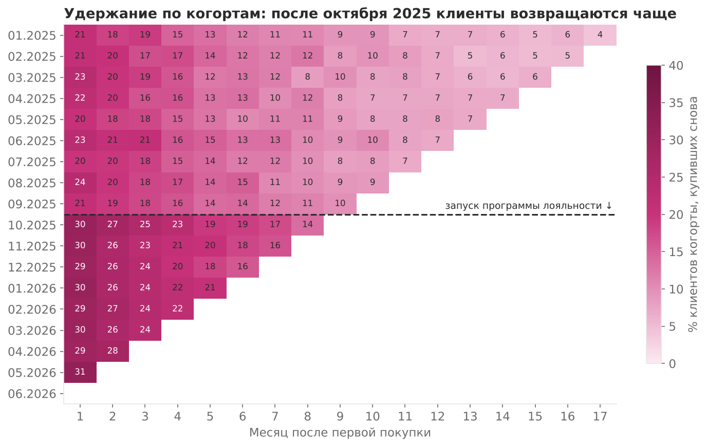
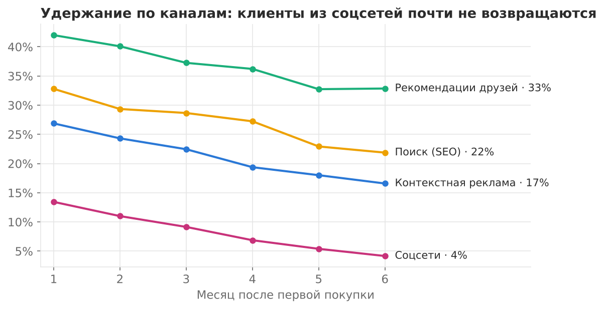
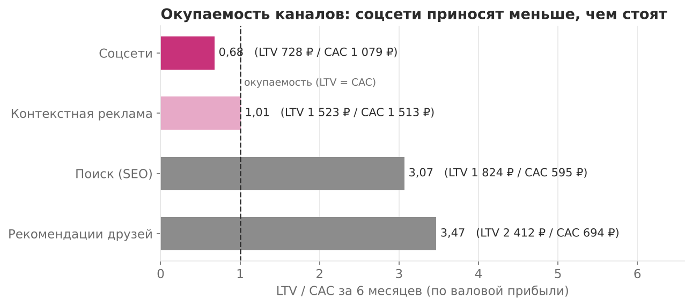
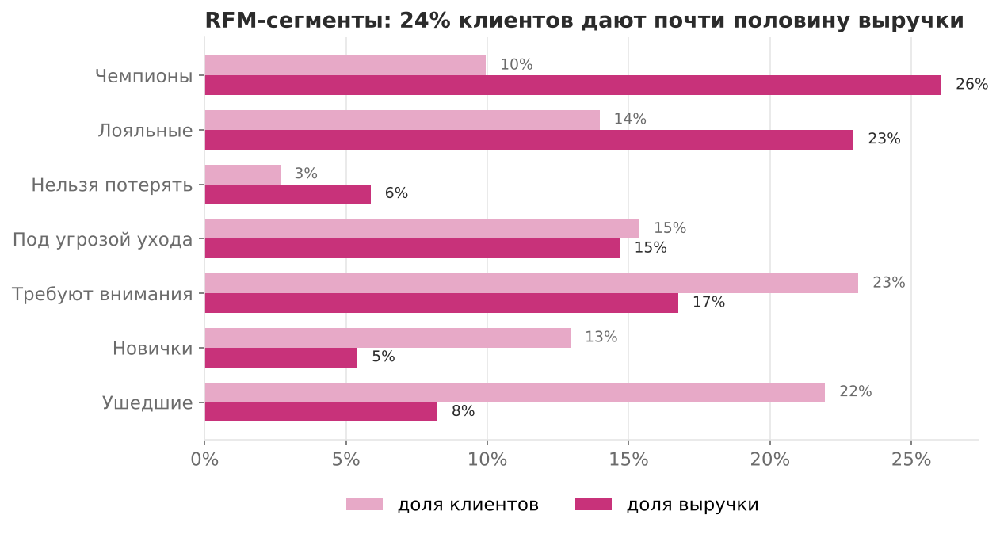

# Когорты, удержание и RFM: куда уходят клиенты интернет-магазина


Продуктовый анализ интернет-магазина косметики за 18 месяцев: кто возвращается за повторной покупкой,
какие каналы привлечения окупаются и на каких клиентах держится выручка.
Основная работа — **SQL** (CTE, оконные функции, когорты), Python — для запуска и графиков.

**Стек:** SQL (DuckDB, совместим с PostgreSQL) · Python · pandas · matplotlib · pytest

---

## Данные

| Таблица | Что внутри |
|---|---|
| `customers` | 27 896 клиентов: дата первой покупки, канал привлечения, город |
| `orders` | 62 102 заказа, январь 2025 — июнь 2026 |
| `marketing` | расходы на привлечение по месяцам и каналам |

## Главное

> 1. **Соцсети не окупаются.** Это 40% новых клиентов и 40% маркетингового бюджета, но LTV/CAC = **0,68**:
>    за полгода клиент приносит 728 ₽ валовой прибыли при стоимости привлечения 1 079 ₽.
> 2. **Программа лояльности работает.** После запуска в октябре 2025 повторные покупки в 1-й месяц выросли
>    с **21,6% до 29,7%**, в 3-й — с 18,0% до 23,7%.
> 3. **24% клиентов дают 49% выручки** (сегменты «Чемпионы» и «Лояльные»).
>    Ещё 15% клиентов «под угрозой ухода» — это 15% выручки, которую можно потерять.

## 1. Удержание по когортам

Когорта — клиенты, сделавшие первую покупку в одном месяце. Ячейка — доля когорты, купившей снова через N месяцев
([`sql/01_cohort_retention.sql`](sql/01_cohort_retention.sql)).



Граница видна сразу: когорты с октября 2025 возвращаются заметно чаще.

## 2. Удержание по каналам

Когорты января–декабря 2025, у которых было не меньше 6 месяцев на повторную покупку
([`sql/02_retention_by_channel.sql`](sql/02_retention_by_channel.sql)).

| Канал | Клиентов | Купили в 1-й мес. | в 3-й | в 6-й |
|---|---|---|---|---|
| Рекомендации друзей | 1 729 | 42,0% | 37,2% | 32,9% |
| Поиск (SEO) | 3 507 | 32,8% | 28,7% | 21,9% |
| Контекстная реклама | 5 265 | 26,9% | 22,5% | 16,6% |
| Соцсети | 7 064 | 13,4% | 9,1% | **4,2%** |



## 3. Окупаемость каналов: LTV / CAC

LTV — валовая прибыль с клиента за 6 месяцев (выручка × маржа 30%), CAC — расходы канала на одного нового клиента
([`sql/03_ltv_cac.sql`](sql/03_ltv_cac.sql)).



Контекстная реклама выходит в ноль только к шестому месяцу, соцсети за полгода не окупаются.
Дешевле всех обходятся и дольше всех остаются клиенты из поиска и по рекомендациям.

## 4. Программа лояльности

Сравнение 6 когорт до запуска (апрель–сентябрь 2025) и 6 после (октябрь 2025 – март 2026)
([`sql/05_loyalty_effect.sql`](sql/05_loyalty_effect.sql)):

| | Клиентов | 1-й месяц | 2-й | 3-й |
|---|---|---|---|---|
| До программы | 8 388 | 21,6% | 19,4% | 18,0% |
| После запуска | 10 472 | **29,7%** | **26,3%** | **23,7%** |

Структура каналов в обоих периодах почти одинаковая (доля соцсетей 39% и 40%), так что рост не объясняется
сменой источников трафика. **Но это сравнение «до/после», а не эксперимент**: в период «после» попали ноябрь
и декабрь с сезонным спросом. Для точной оценки эффекта стоит оставить небольшую контрольную группу без программы.

## 5. RFM-сегментация

Клиенты оцениваются по давности последней покупки (R), числу покупок (F) и сумме (M)
([`sql/04_rfm.sql`](sql/04_rfm.sql)). R и M делятся на квинтили через `NTILE(5)`.
Для F это не работает: у 42% клиентов одна покупка, и `NTILE` разбросал бы одинаковых клиентов по разным
группам случайно, поэтому F считается по порогам.



| Сегмент | Доля клиентов | Доля выручки | Что делать |
|---|---|---|---|
| Чемпионы | 10% | 26% | ранний доступ к новинкам, не заваливать скидками |
| Лояльные | 14% | 23% | персональные подборки, повышение уровня в программе лояльности |
| Нельзя потерять | 3% | 6% | личное письмо и сильное предложение: покупали часто, но давно не заходили |
| Под угрозой ухода | 15% | 15% | реактивация: напоминание о любимых товарах, бонус на следующий заказ |
| Новички | 13% | 5% | цепочка писем после первой покупки — вторая покупка решает, останется ли клиент |

## Рекомендации

1. **Пересобрать бюджет соцсетей**: сократить или перевести на ретаргетинг тех, кто уже покупал.
   Освободившиеся деньги — в SEO и реферальную программу, у которых LTV/CAC выше 3.
2. **Сохранить программу лояльности** и проверить её эффект на контрольной группе.
3. **Запустить реактивацию** сегментов «Под угрозой ухода» и «Нельзя потерять» — это пятая часть выручки.
4. **Добавить в отчётность удержание по каналам**, а не только стоимость клиента: дешёвый клиент,
   который не возвращается, обходится дороже.

## SQL-приёмы в проекте

- когортный анализ: `DATE_TRUNC`, номер месяца от первой покупки, `COUNT(DISTINCT)`;
- условная агрегация: `COUNT(DISTINCT CASE WHEN ...)` для удержания в 1-й, 3-й, 6-й месяц;
- оконные функции: `NTILE` для RFM, `LAG` для роста выручки к прошлому месяцу;
- `JOIN` трёх таблиц для LTV/CAC, интервалы дат (`+ INTERVAL 6 MONTH`).

Корректность запросов проверяется тестами на маленьком наборе, где правильный ответ известен заранее
([`tests/test_sql.py`](tests/test_sql.py)) — включая подвох с календарными месяцами (покупки 31 января и 1 марта —
это 2-й месяц когорты, хотя прошёл всего месяц).

## Структура

```
├── sql/                     # 6 запросов: когорты, каналы, LTV/CAC, RFM, лояльность, выручка
├── cohorts/
│   ├── generate.py          # генерация данных
│   ├── data.py              # загрузка CSV в DuckDB и запуск SQL
│   └── report.py            # прогон запросов, цифры и графики
├── data/                    # customers.csv, orders.csv, marketing.csv
├── images/                  # графики
└── tests/test_sql.py        # проверка SQL на эталонных данных
```

## Запуск

```bash
pip install -r requirements.txt
python -m cohorts.report     # цифры в консоль + графики в images/
pytest -q
```

## О данных

Данные синтетические ([`cohorts/generate.py`](cohorts/generate.py)), чтобы проект можно было выложить публично.
Закономерности в них заложены так, как они обычно выглядят в реальном e-commerce: разное качество каналов,
затухание удержания, эффект программы лояльности.

---

Автор: Мария Вилькевичуте · [GitHub](https://github.com/mvilkevichute-2023)
